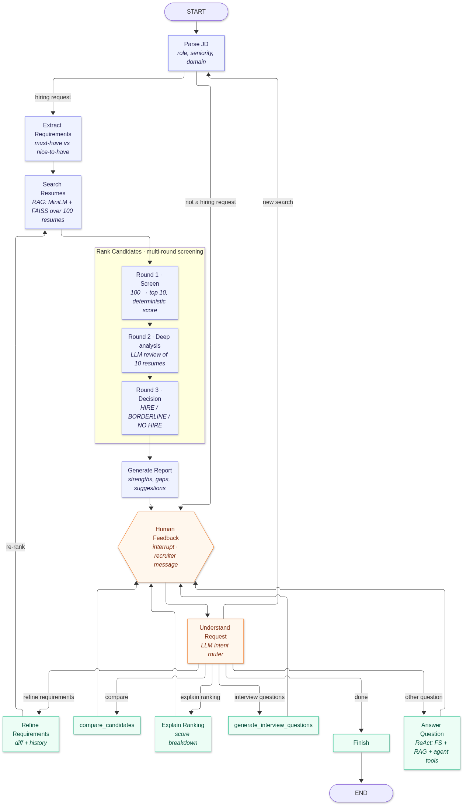
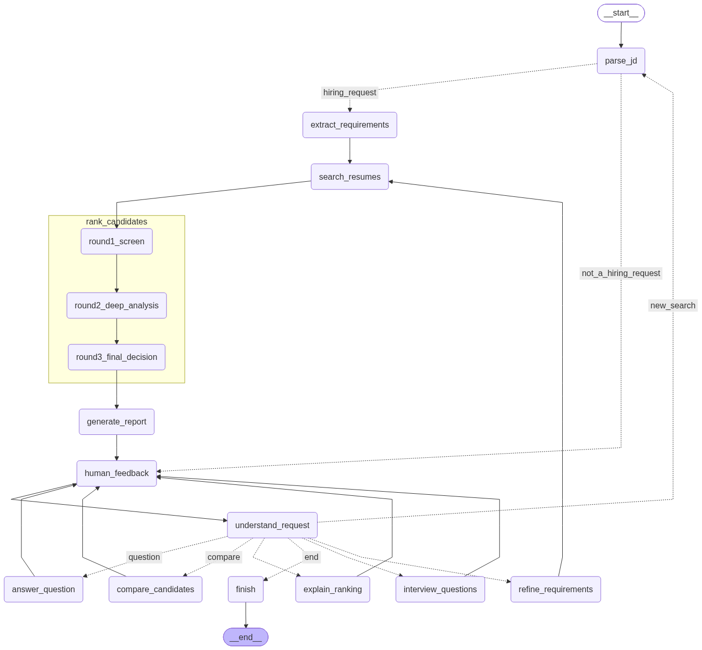

# 🎯 TalentScout — LangGraph Resume ⇄ JD Matching Agent

An AI recruiting agent built with **LangGraph**. It reads a job description (or a natural-language request
such as *"Find me candidates with React and 3+ years experience"*), searches **100 resumes** with RAG, runs a
**three-round screening** (100 → top 10 → deep review → hire / borderline / no-hire), writes an **explainable
match report**, and then keeps chatting. The recruiter can compare candidates, ask *"why did John rank higher
than Jane?"*, change requirements mid-conversation (the agent re-ranks and explains what moved), and request
interview questions.

| Brief requirement | Implementation |
|---|---|
| **A. LangGraph agent** `matching_agent.py` | `StateGraph` with typed `AgentState`, 13 nodes + a 3-node ranking subgraph, `interrupt()`-based human-in-the-loop, `InMemorySaver` checkpointer |
| State: conversation history | `messages` (`add_messages` reducer), `turn` |
| State: job requirements understanding | `jd_profile`, `requirements`, `requirements_history`, `requirement_changes` |
| State: shortlist + reasoning | `round1` (all 100 scored), `shortlist`, `deep_analysis`, `decisions`, `final_ranking`, `ranking_changes`, `trace` |
| Workflow START → Parse JD → Extract Requirements → Search Resumes → Rank Candidates → Generate Report → Human Feedback Loop → END | Exactly these nodes. See the diagrams below |
| File system tools (Milestone 1) | `talentscout/resume_store.py` (parser) and `talentscout/tools/fs_tools.py`: `list_resumes`, `read_resume`, `get_candidate_profile`, `search_resumes_by_keyword`, `save_report`, `list_saved_reports` |
| RAG search tool (Milestone 2) | `talentscout/rag.py`: MiniLM bi-encoder + FAISS + cross-encoder rerank, exposed as the `rag_search` tool |
| `extract_requirements(jd)` | must-have vs nice-to-have, per-skill minimum years, minimum total years |
| `compare_candidates(candidate_ids)` | factual head-to-head table and an LLM verdict |
| `generate_interview_questions(candidate_id)` | 6–8 questions aimed at the candidate's strengths and gaps, what a good answer looks like, and red flags |
| **B. Conversational interface** | LLM intent router (`understand_request`): refine · new search · compare · explain · interview questions · free-form Q&A (ReAct with tools) · end |
| Iterative refinement | `refine_requirements` → re-runs search and ranking → report lists requirement diffs and every rank movement with a reason |
| **C. Multi-round screening** | Round 1 screen of all 100 → Round 2 LLM deep analysis of the top 10 → Round 3 hire / borderline / no-hire |
| Explainability | Per-candidate score breakdown, must-have evidence, strengths with quotes, gaps, risks, decision rationale, improvement suggestions for borderline candidates, near-misses |
| **Submission** | Diagrams in `docs/`, chat UI `app.py` (Streamlit) and `cli.py`, 6 conversation-flow tests plus transcripts, demo script in `docs/DEMO_SCRIPT.md` |

---

## State machine

**Conceptual view** (`docs/architecture.png`):



**Generated from the compiled LangGraph** (`docs/state_machine.png`, produced by `python scripts/draw_graph.py`):



### Nodes
| Node | What it does |
|---|---|
| `parse_jd` | LLM structured output → role title, seniority, domain, responsibilities. Detects a full JD, a short search or non-hiring chat |
| `extract_requirements` | Calls the `extract_requirements` tool → must-have / nice-to-have, with skill names normalised to a taxonomy (React = ReactJS = React.js) |
| `search_resumes` | RAG: semantic relevance of **every** resume to the requirement query, must-have coverage counts, and the top reranked evidence chunks |
| `rank_candidates` (subgraph) | `round1_screen` → `round2_deep_analysis` → `round3_final_decision` |
| `generate_report` | Writes the full markdown report to `reports/` and posts a concise chat summary. After a refinement it also shows what changed and why |
| `human_feedback` | `interrupt()` pauses the graph until the recruiter replies (resumed with `Command(resume=...)`) |
| `understand_request` | LLM router plus deterministic safety nets ("top 3" → IDs; any "why … rank" → explainer) |
| `refine_requirements` | Applies the change, records history and a precise diff, then loops back to `search_resumes` to re-rank |
| `compare_candidates` / `explain_ranking` / `interview_questions` | Action nodes that use the agent tools |
| `answer_question` | ReAct loop with all 12 tools (file system, RAG, agent tools) for free-form questions |
| `finish` | Closes the session with the recommended hires |

---

## Scoring (transparent by design)

**Round 1, all 100 resumes, deterministic and reproducible**

```
round1 = 45% must-have coverage + 15% nice-to-have coverage + 20% experience fit + 20% semantic relevance
```
- **Skill credit:** a skill used in a described role gets full credit, scaled by years when the JD asks for N+ years. A skill that is only listed in the skills section gets 40% (this catches keyword stuffing). A missing skill gets 0.
- **Years:** per-skill years come from the date ranges of the roles where the skill appears. Total experience merges overlapping roles.
- **Semantic relevance:** cosine similarity of resume chunks to the requirement query (MiniLM + FAISS), min-max normalised across the pool.

**Round 2, top 10.** The LLM reads each full resume and produces a calibrated fit score (0–100), evidence for each must-have (demonstrated / mentioned only / missing), strengths with quotes, gaps, risks and a seniority read. Then `final = 40% Round 1 + 60% deep fit`.

**Round 3.** A hiring-committee decision (HIRE / BORDERLINE / NO HIRE) with a confidence level and rationale, plus improvement suggestions for every borderline candidate. A deterministic guardrail ensures a candidate missing a must-have can never be HIRE.

Because the scores are numeric, *"Why did John rank higher than Jane?"* is answered from a real component breakdown:

| Round-1 component (weighted pts) | John Carter | Jane Fernandes | Δ |
|---|---|---|---|
| must-have coverage | 45.0 | 15.0 | +30.0 |
| nice-to-have coverage | 12.0 | 0.0 | +12.0 |
| semantic relevance | 20.0 | 15.0 | +5.0 |
| experience fit | 20.0 | 20.0 | +0.0 |

---

## Quick start

```bash
python3 -m venv .venv && source .venv/bin/activate
pip install -r requirements.txt
cp .env.example .env               # add your OPENROUTER_API_KEY

python scripts/generate_resumes.py # 100 synthetic resumes -> data/resumes/ (already included)
python scripts/build_index.py      # FAISS index -> vector_store/ (auto-built on first use, ~1 min)

streamlit run app.py               # chat UI  → http://localhost:8501
python cli.py                      # or the terminal chat
python cli.py --jd data/jds/senior_frontend_engineer.md
```

The LLM is reached through **OpenRouter** with `langchain_openai.ChatOpenAI(base_url="https://openrouter.ai/api/v1")`.
The default model is `openai/gpt-4.1-mini`; override it with `TALENTSCOUT_MODEL`. Embeddings and reranking run locally, so
no second API key is needed. A full screening run costs about $0.02.

### Things to try in the chat
1. Pick **Senior Frontend Engineer** in the sidebar → *Screen candidates*
2. `Compare the top 3 matches side by side`
3. `Why did John rank higher than Jane?`
4. `Make AWS a must-have and drop the Jest requirement` (re-ranks and explains the changes)
5. `Generate interview questions for Meera`
6. `Which shortlisted candidates have mentored engineers? Check the resumes.` (uses tools)
7. `Why isn't Vikram shortlisted?` (a keyword-stuffer caught by the "listed only" rule)
8. `done`

---

## Tests and conversation flows

```bash
pytest -q                     # 16 offline unit tests (parsing, scoring, diffs, router rules, graph structure)
pytest -m llm -v              # 6 live conversation-flow tests (OpenRouter)
python scripts/run_scenarios.py   # runs 6 documented flows, writes transcripts to docs/test_scenarios/
```

| # | Flow | Covers |
|---|---|---|
| 1 | Full JD → three-round screening → report → hire decision | Part A pipeline, Part C multi-round and report |
| 2 | "Find me candidates with React and 3+ years" → compare top 3 → why John > Jane | Part B natural-language queries |
| 3 | Backend JD → make Kafka a must-have → relax years → why the top changed | Part B iterative refinement and re-ranking explanations |
| 4 | ML JD → borderline candidates and improvements → why a candidate isn't shortlisted → interview questions | Part C explainability |
| 5 | DevOps JD → certification lookup (file system) → semantic question (RAG) → save summary file | Tools |
| 6 | "hello" → data-engineer search → switch to a new role → end | Edge cases, new search, END |

---

## Project layout

```
matching_agent.py          # LangGraph state, nodes, graph, MatchingAgent session wrapper
app.py                     # Streamlit chat UI (chat + live reasoning, shortlist, report, graph tabs)
cli.py                     # Rich terminal chat
talentscout/
  config.py                # paths, model, weights, LLM factory (OpenRouter)
  schemas.py               # Pydantic schemas for every structured LLM output
  prompts.py               # all prompts
  skills.py                # skill taxonomy + alias matching
  resume_store.py          # Milestone 1: resume reading/parsing (.md/.txt/.pdf), per-skill years
  rag.py                   # Milestone 2: chunking, MiniLM + FAISS, cross-encoder rerank
  scoring.py               # Round-1 scoring, pairwise breakdowns, requirement/ranking diffs
  report.py                # match report + chat summary rendering
  tools/fs_tools.py        # file-system + RAG tools
  tools/agent_tools.py     # extract_requirements, compare_candidates, generate_interview_questions, rounds 2-3
data/resumes/              # 100 synthetic resumes (deterministic generator, seed 42)
data/jds/                  # 4 sample job descriptions
docs/                      # diagrams, demo script, scenario transcripts
scripts/                   # generate_resumes, build_index, draw_graph, run_scenarios
tests/                     # unit + live flow tests
reports/                   # generated match reports
```

## Design notes
- **Human-in-the-loop:** `interrupt()` re-executes its node when resumed, so `human_feedback` contains only the interrupt. The routing LLM call lives in the next node (`understand_request`), which keeps resumes idempotent.
- **Subgraph state sharing:** the ranking subgraph returns the full inherited `trace`, so the trace uses an id-deduplicating reducer rather than `operator.add`.
- **Grounded explanations:** the LLM never invents scores. It narrates numbers computed by `scoring.py`, and comparison tables are built deterministically.
- **Synthetic data:** the 100 resumes are generated (no personal data). They include planted personas for the demo: John Carter (strong senior React), Jane Fernandes (React without TypeScript or testing), Meera Iyer (strong TypeScript, only 1.7 years of React → borderline) and Vikram Malhotra (lists React but never used it → caught by the listed-only rule).
